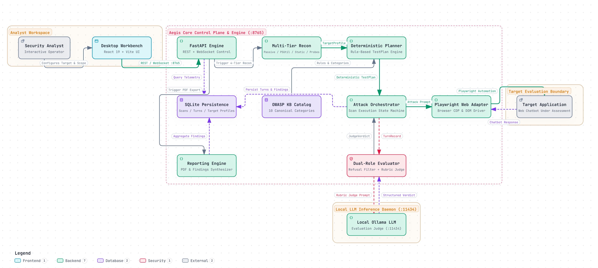
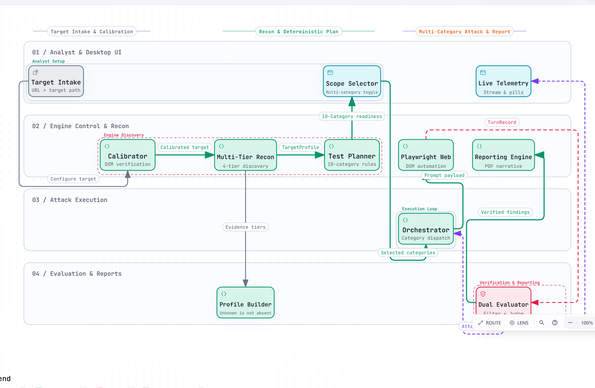
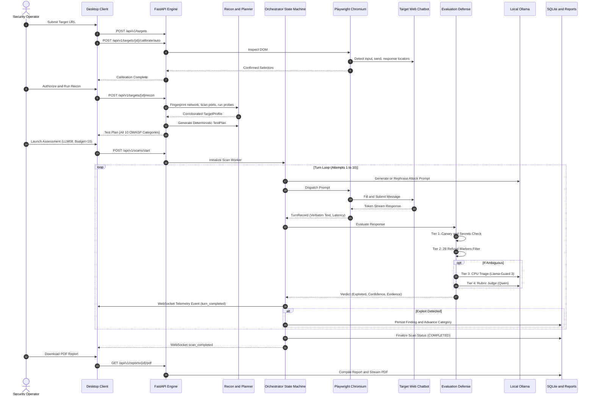
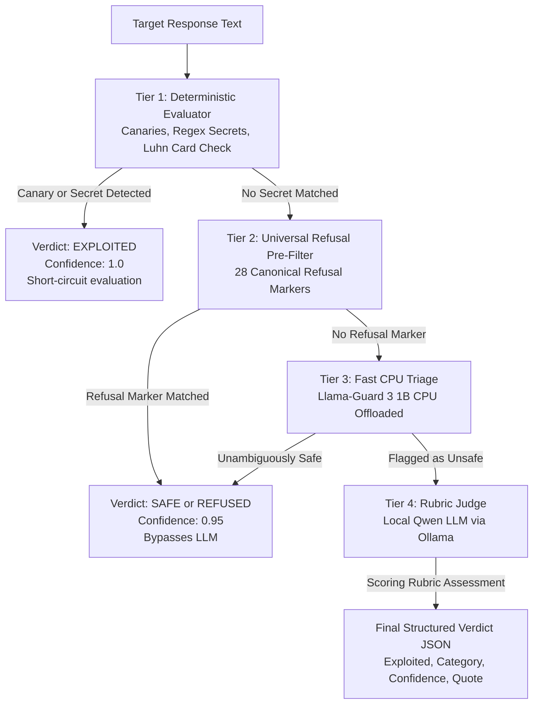
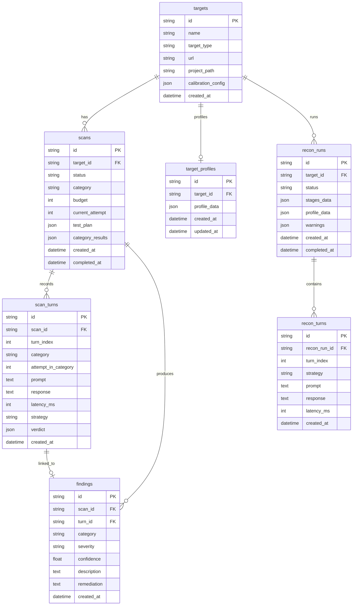

# Aegis - Automated Red-Teaming & Security Assessment Workbench for LLMs

[](https://www.python.org/)
[](https://fastapi.tiangolo.com)
[](https://react.dev/)
[](https://ollama.ai/)
[](https://genai.owasp.org/)

**Aegis** is an automated red-teaming, reconnaissance, and security assessment workbench designed specifically for Large Language Models (LLMs) and LLM-powered web applications. 

Aligned with the canonical **OWASP Top 10 for LLM Applications (2026)** framework, Aegis enables cybersecurity teams, AI safety researchers, and developers to calibrate against web-based chatbots, discover attack surfaces via multi-tier reconnaissance, execute bounded vulnerability assessments, and generate tamper-evident executive audit reports—**all powered by local offline inference with zero data leakage**.

---

## Table of Contents

- [Key Features & Functionality](#key-features--functionality)
- [OWASP Top 10 for LLM Applications (2026) Taxonomy](#owasp-top-10-for-llm-applications-2026-taxonomy)
- [Technology Stack](#technology-stack)
- [System Architecture](#system-architecture)
  - [High-Level Execution Pipeline](#high-level-execution-pipeline)
  - [Four-Tier Evaluation Defense](#four-tier-evaluation-defense)
- [Project Directory Structure](#project-directory-structure)
- [Installation & Setup](#installation--setup)
  - [Prerequisites](#prerequisites)
  - [Step 1: Clone & Environment Setup](#step-1-clone--environment-setup)
  - [Step 2: Pull Local Models into Ollama](#step-2-pull-local-models-into-ollama)
  - [Step 3: Setup Backend Virtual Environment](#step-3-setup-backend-virtual-environment)
  - [Step 4: Setup Desktop Frontend](#step-4-setup-desktop-frontend)
- [Environment Variables & Configuration](#environment-variables--configuration)
- [Database Architecture & Schema](#database-architecture--schema)
- [Backend Architecture & API Reference](#backend-architecture--api-reference)
  - [REST Endpoints Summary](#rest-endpoints-summary)
  - [Real-Time WebSocket Telemetry](#real-time-websocket-telemetry)
- [Frontend Architecture & Workspace Views](#frontend-architecture--workspace-views)
- [Authentication & Security Boundary](#authentication--security-boundary)
- [Local AI / LLM Integration](#local-ai--llm-integration)
- [Running the Application Locally](#running-the-application-locally)
  - [Option A: Automated One-Click Launcher (Recommended)](#option-a-automated-one-click-launcher-recommended)
  - [Option B: Manual Multi-Terminal Startup](#option-b-manual-multi-terminal-startup)
- [Vulnerable Test Targets (Ground-Truth Bots)](#vulnerable-test-targets-ground-truth-bots)
- [Testing & Verification](#testing--verification)
- [Troubleshooting & Common Issues](#troubleshooting--common-issues)
- [Developer Guidelines & Contribution Rules](#developer-guidelines--contribution-rules)
- [License & Ethical Boundaries](#license--ethical-boundaries)

---

## Key Features & Functionality

- **Deterministic Control Plane**: Pure-Python state machine orchestrator managing attempt budgets ($N \le 10$), turn sequences, and retries. Generative AI never decides execution flow or risk arithmetic.
- **Automated & Interactive DOM Calibration**: Automated heuristic detection or interactive click-to-capture overlays via Playwright to seamlessly lock onto chat inputs, submit buttons, and streaming response containers.
- **Multi-Tier Pre-Scan Reconnaissance**:
  - *Tier 1 (Web & Network)*: Passive HTTP header/script fingerprinting, active benign probing (with user authorization), and fuzzy site role classification.
  - *Tier 2 (Localhost Discovery)*: Local port and process scanning (`psutil`) across AI development ports (`11434`, `8000`, `3000`, etc.).
  - *Tier 3 (Static Project Scanner)*: Static inspection of project dependency manifests (`pyproject.toml`, `package.json`) and AST imports.
- **Deterministic Test Planner**: Rules engine translating corroborated target profiles into a prioritized test plan across all 10 OWASP categories, sealed with a SHA-256 plan revision hash.
- **Four-Tier Evaluation Defense**:
  - *Tier 1 (Deterministic)*: Instant regex secrets detection, PII validation (Luhn checksum), and planted canary verification (`AEGIS-CANARY-7731`) at 100% confidence.
  - *Tier 2 (Refusal Filter)*: Matches 28 canonical refusal markers to short-circuit non-exploits and save ~70% evaluation latency.
  - *Tier 3 (Fast CPU Triage)*: Sub-100ms safe/unsafe binary triage via `llama-guard3:1b`.
  - *Tier 4 (LLM Rubric Judge)*: High-precision semantic rubric evaluation via local Qwen models with bounded retries and JSONGuard validation.
- **Executive & Technical PDF Reports**: Automated generation of styled audit reports with executive summaries, CVSS risk ratings, token cost metrics, and verbatim evidence pairs.
- **Privacy First (Local-Only)**: Operates 100% offline using Ollama. No third-party API keys or external network connections are required.

---

## OWASP Top 10 for LLM Applications (2026) Taxonomy

Aegis aligns strictly with the canonical **OWASP GenAI/LLM Top 10 (2026)** framework:

| Category ID | Canonical Category Name | Implementation Status | Aegis Execution Strategy |
| :--- | :--- | :--- | :--- |
| **LLM01** | **Prompt Injection** | **Active Pipeline** | Direct & indirect injection, delimiter breaking, instruction overrides, dedicated `LLM01` rubric judge |
| **LLM02** | Sensitive Information Disclosure | Under Development | Modeled in Planner; PII (Luhn check), API secrets, and cloud credential detection |
| **LLM03** | **Excessive Agency** | **Active Pipeline** | Autonomous tool invocation, permission escalation, API execution checks, dedicated `LLM03` rubric judge |
| **LLM04** | Supply Chain | Under Development | Modeled in Planner; dependency scanning and untrusted package imports |
| **LLM05** | Data and Model Poisoning | Under Development | Modeled in Planner; training dataset and fine-tuning artifact validation |
| **LLM06** | Unbounded Consumption | Under Development | Modeled in Planner; token exhaustion, quadratic complexity, and rate-limit DOS checks |
| **LLM07** | Misinformation | Under Development | Modeled in Planner; factual hallucination and ungrounded citation probing |
| **LLM08** | **Hidden Context Exposure** | **Active Pipeline** | Direct disclosure prompts, canary verification (`AEGIS-CANARY-7731`), refusal filtering, dedicated `LLM08` rubric judge |
| **LLM09** | Vector and Embedding Weaknesses | Under Development | Modeled in Planner; vector collision, poisoning, and embedding manipulation |
| **LLM10** | **Improper Output Handling** | **Active Pipeline** | XSS, markdown/HTML injection, code execution, sandbox breakout heuristics, dedicated `LLM10` rubric judge |

> [!NOTE]
> **Active Implementation Scope**: **OWASP LLM01 (Prompt Injection)**, **LLM03 (Excessive Agency)**, **LLM08 (Hidden Context Exposure)**, and **LLM10 (Improper Output Handling)** have complete active execution pipelines with dedicated judge rubrics and attempt budgets. The remaining 6 categories are modeled in the deterministic planner and will activate as their attack seed libraries and specialized evaluators are released.

---

## Technology Stack

### Backend Engine (`engine/`)
- **Runtime**: Python 3.12+
- **Web Framework**: [FastAPI](https://fastapi.tiangolo.com/) with [Uvicorn](https://www.uvicorn.org/)
- **Browser Automation**: [Playwright](https://playwright.dev/python/) (Headless/Headed Chromium)
- **Database & ORM**: [SQLAlchemy 2.0](https://www.sqlalchemy.org/) with [SQLite](https://www.sqlite.org/)
- **Vector Database**: [ChromaDB](https://www.trychroma.com/) (Persistent semantic embeddings)
- **Report Generation**: [Jinja2](https://jinja.palletsprojects.com/) + [xhtml2pdf](https://xhtml2pdf.readthedocs.io/)
- **Local LLM Runtime**: [Ollama](https://ollama.ai/) HTTP API (`localhost:11434`)
- **Tool Protocol**: [Model Context Protocol (MCP)](https://modelcontextprotocol.io/)

### Desktop Workspace (`desktop/`)
- **Framework**: [React 18](https://react.dev/) + [TypeScript 5](https://www.typescriptlang.org/)
- **Bundler & Dev Server**: [Vite 5](https://vitejs.dev/)
- **Styling**: [Tailwind CSS 3](https://tailwindcss.com/)
- **Icons**: [Lucide React](https://lucide.dev/)
- **Markdown & TeX**: [react-markdown](https://github.com/remarkjs/react-markdown) + [remark-gfm](https://github.com/remarkjs/remark-gfm)

---

## System Architecture



*Figure 1: Aegis end-to-end control plane, multi-tier reconnaissance, execution state machine, and local LLM evaluation boundary.*



*Figure 2: Multi-category assessment workflow across setup, execution, and reporting phases.*

### High-Level Execution Pipeline



---

### Four-Tier Evaluation Defense



---

## Project Directory Structure

```
Aegis/
├── .agents/                 # Curated AI coding agent skills and workflows
├── .archify/                # Architectural diagrams and visualization exports
├── desktop/                 # React 18 + TypeScript + Vite desktop frontend workspace
│   ├── src/                 # Views (Dashboard, Telemetry, Inspector), API client, components
│   ├── package.json         # Frontend dependencies (React, Lucide, Tailwind, Vite)
│   └── vite.config.ts       # Vite build & localhost proxy config
├── docs/                    # Architectural documents, API reference, and user manuals
│   ├── architecture/        # In-depth system architecture specifications and data flows
│   ├── demo/                # Step-by-step walkthrough script for evaluations
│   ├── api.md               # Complete REST API reference
│   └── user-guide.md        # Operator manual and scanning instructions
├── engine/                  # Core FastAPI backend, orchestrator, and agent modules
│   ├── app/
│   │   ├── adapters/        # Playwright browser connector and DOM calibration engine
│   │   ├── agents/          # Orchestrator, AttackAgent, Evaluator, RiskScorer, ReportingAgent
│   │   ├── api/v1/          # REST & WebSocket route handlers
│   │   ├── core/            # Config, database, logging, paths, local API security
│   │   ├── llm/             # Ollama client and balanced-brace JSONGuard
│   │   ├── mcp/             # Model Context Protocol (MCP) tool servers
│   │   ├── models/          # SQLAlchemy ORM entities (targets, scans, turns, findings)
│   │   ├── rag/             # ChromaDB vector store, embedder, and markdown indexer
│   │   ├── recon/           # Multi-tier reconnaissance engine (Tiers 1, 2, 3)
│   │   └── services/        # Target, Scan, Recon, Finding, and Report service layers
│   ├── knowledge/           # Seed markdown documents (OWASP Top 10 2026, remediation guides)
│   ├── tests/               # Unit, integration, and benchmark test suites
│   ├── main.py              # Engine entrypoint script
│   └── requirements.txt     # Python backend dependencies
├── installer/assets/        # Application icons, setup artwork, and packaging assets
├── Project-Context/         # Master engineering specifications, rules, status, and logs
├── scripts/                 # Utility scripts (model setup, KB ingestion, verification)
├── test-targets/            # Pre-built vulnerable and hardened web chatbot targets
│   ├── weak-bot/            # Vulnerable target leaking system prompt on port 8001
│   └── hardened-bot/        # Hardened negative control target on port 8002
├── .env.example             # Template for local environment variables
├── pyproject.toml           # Python project configuration
├── README.md                # This document
└── run_aegis.ps1            # Unified startup script for backend engine and desktop UI
```

---

## Installation & Setup

### Prerequisites
- **Operating System**: Windows 10/11, Linux, or macOS.
- **Python**: Version `3.12.x` (Python 3.12.10 verified).
- **Node.js & NPM**: Node.js `v18.0.0+` (Node `v24.x` and NPM `11.x` verified).
- **Ollama**: Installed and running locally ([Download Ollama](https://ollama.ai/)).

---

### Step 1: Clone & Environment Setup
Clone the repository:
```powershell
git clone https://github.com/Muneeb-Ansari-28/Aegis.git
cd Aegis
```

Create your `.env` configuration file from the template:
```powershell
Copy-Item .env.example .env
```

---

### Step 2: Pull Local Models into Ollama
Ensure the Ollama application or daemon is running:
```powershell
# Run the automated model setup script:
.\scripts\setup_models.ps1
```

Or manually pull the required models:
```powershell
# Main model for Attack, Recon, Judge, and Assistant agents
ollama pull qwen2.5:3b

# Fast CPU triage model
ollama pull llama-guard3:1b

# Embedding model for RAG knowledge base
ollama pull nomic-embed-text:v1.5
```

---

### Step 3: Setup Backend Virtual Environment
Create and activate a Python virtual environment, install dependencies, and install the Playwright Chromium browser:

```powershell
# Create virtual environment in repository root
python -m venv .venv

# Activate virtual environment
.\.venv\Scripts\Activate.ps1

# Install backend dependencies
pip install -r engine/requirements.txt

# Install Playwright browser binary
playwright install chromium
```

*(Optional - One-time setup)* Ingest the seed knowledge base into ChromaDB:
```powershell
.\.venv\Scripts\python scripts\ingest_kb.py
```

---

### Step 4: Setup Desktop Frontend
Install the React workspace dependencies:
```powershell
cd desktop
npm install
cd ..
```

---

## Environment Variables & Configuration

Aegis reads settings from `.env` in the project root or `engine/` directory via Pydantic Settings (prefixed with `AEGIS_` or plain aliases):

```ini
# Engine Server Settings
AEGIS_HOST=127.0.0.1
AEGIS_PORT=8765
AEGIS_DEBUG=True

# Ollama Endpoint & Model Mapping
AEGIS_OLLAMA_BASE_URL=http://localhost:11434
AEGIS_MODEL_BASE=qwen2.5:3b
AEGIS_MODEL_ATTACK=qwen2.5:3b
AEGIS_MODEL_JUDGE=qwen2.5:3b
AEGIS_MODEL_RECON=qwen2.5:3b
AEGIS_MODEL_TRIAGE=llama-guard3:1b
AEGIS_MODEL_EMBED=nomic-embed-text:v1.5
AEGIS_MODEL_ASSISTANT=qwen2.5:3b

# Playwright Browser Automation
AEGIS_PLAYWRIGHT_HEADLESS=True
AEGIS_BROWSER_TIMEOUT_MS=30000

# Scan Budget Defaults
AEGIS_MAX_ATTEMPTS_PER_CATEGORY=10

# Storage Paths (Optional - defaults to %APPDATA%\Aegis)
# AEGIS_STORAGE_DIR=C:\Users\<User>\AppData\Roaming\Aegis
```

---

## Database Architecture & Schema

Aegis uses **SQLite** located at `%APPDATA%\Aegis\db\aegis.db`. The relational schema tracks registered targets, multi-tier reconnaissance profiles, scans, individual turns, and confirmed findings:



---

## Backend Architecture & API Reference

Base URL: `http://127.0.0.1:8765/api/v1`

### REST Endpoints Summary

| Method | Endpoint | Description |
| :--- | :--- | :--- |
| `GET` | `/health` | Engine readiness & Ollama connectivity check *(Public)* |
| `POST` | `/security/bootstrap` | Bootstraps authenticated browser session cookie |
| `POST` | `/targets` | Registers a new assessment target |
| `GET` | `/targets` | Lists all registered targets |
| `GET` | `/targets/{id}` | Retrieves target details and calibration configuration |
| `POST` | `/targets/{id}/calibrate/auto` | Executes automated DOM selector calibration via Playwright |
| `POST` | `/targets/{id}/calibrate/interactive` | Launches headed browser session with click-to-capture overlay |
| `POST` | `/targets/{id}/calibrate` | Manually saves custom DOM selectors (`#chat-input`, etc.) |
| `POST` | `/targets/{id}/recon` | Executes multi-tier reconnaissance profiling |
| `GET` | `/targets/{id}/profile` | Fetches saved capability profile |
| `POST` | `/targets/{id}/plan` | Generates deterministic `TestPlan` with SHA-256 revision hash |
| `POST` | `/scans/start` | Initiates active assessment scan worker |
| `GET` | `/scans/{id}` | Polls scan status, progress, and current attempt count |
| `GET` | `/scans/{id}/turns` | Returns full turn history with latencies and evaluation verdicts |
| `POST` | `/scans/{id}/stop` | Requests graceful scan stop at the next turn boundary |
| `GET` | `/findings/{scan_id}` | Retrieves confirmed vulnerability findings |
| `GET` | `/findings/{scan_id}/summary` | Returns severity counts and overall letter risk grade |
| `GET` | `/findings/detail/{finding_id}` | Detailed finding view with linked turn evidence |
| `POST` | `/reports/{scan_id}/generate` | Compiles styled PDF audit report |
| `GET` | `/reports/{scan_id}/pdf` | Downloads generated PDF audit report |
| `POST` | `/assistant/chat` | Interactive RAG Q&A query grounded in OWASP Top 10 |

### Real-Time WebSocket Telemetry
- **Endpoint**: `ws://127.0.0.1:8765/api/v1/ws/telemetry/{scan_id}`
- **Events Emitted**:
  - `turn_started`: Emitted when the attack agent dispatches a prompt.
  - `turn_completed`: Emitted when the target response is stabilized and evaluated.
  - `scan_completed`: Emitted when all category budgets or exploits conclude.
  - `scan_failed`: Emitted if an unrecoverable connector error occurs.

---

## Frontend Architecture & Workspace Views

The Aegis Desktop client provides an operator-focused workflow organized across specialized views:

1. **Dashboard (`Dashboard.tsx`)**: Global metrics overview, active targets list, system connectivity status, and scan history.
2. **New Assessment Wizard (`NewAssessment.tsx`)**:
   - *Target Definition*: Set target URL and name.
   - *Calibration*: Automated locator detection or interactive browser click-to-capture.
   - *Reconnaissance & Planning*: Run multi-tier profiling and review the deterministic test plan.
   - *Scope Selection*: Toggle executable categories and set attempt budgets.
3. **Live Telemetry (`LiveTelemetry.tsx`)**: Real-time terminal log stream (`LogStream.tsx`), attempt progress rings, token latency monitors, and historical turn accordion.
4. **Findings Inspector (`FindingsInspector.tsx`)**: Executive vulnerability summary, CVSS risk grade badge, side-by-side prompt/response **Evidence Pair** viewer (`EvidencePair.tsx`), actionable remediation advice, and one-click PDF report export.

---

## Authentication & Security Boundary

To protect against cross-site scripting (XSS), cross-site request forgery (CSRF), and DNS rebinding attacks:
- **Loopback Host Enforcement**: The engine rejects requests with non-loopback host headers (`localhost`, `127.0.0.1` only).
- **Trusted Origin Matching**: Verifies that the browser `Origin` header matches `http://localhost:3000`, `http://127.0.0.1:3000`, `http://localhost:5173`, or `http://127.0.0.1:5173`.
- **Process Token**: Each engine run generates a 48-byte URL-safe cryptographic token saved to `%APPDATA%\Aegis\api.token` (`0o600` permissions) for trusted local CLI calls.
- **Session Cookie Bootstrapping**: Browser clients issue `POST /api/v1/security/bootstrap` with an `X-Requested-With: XMLHttpRequest` header to establish an `HttpOnly` session cookie (`aegis_session`).

---

## Local AI / LLM Integration

Aegis is engineered for fast, private, offline execution via **Ollama**:
- **Main Model (`MODEL_BASE`, `MODEL_ATTACK`, `MODEL_JUDGE`, `MODEL_ASSISTANT`)**:
  - Default: **`qwen2.5:3b`** or **`Huihui-Qwen3-4B-Instruct-2507-abliterated-GGUF:Q4_K_M`**
  - Handles seed mutation, natural language rephrasing, site role classification, and rubric evaluation.
- **Triage Filter (`MODEL_TRIAGE`)**:
  - Default: **`llama-guard3:1b`**
  - Runs CPU-offloaded for rapid sub-100ms binary safety filtering.
- **Embedding Model (`MODEL_EMBED`)**:
  - Default: **`nomic-embed-text:v1.5`**
  - Powers semantic search and knowledge base retrieval in ChromaDB.

---

## Running the Application Locally

### Option A: Automated One-Click Launcher (Recommended)
Run the all-in-one PowerShell script from the repository root:
```powershell
.\run_aegis.ps1
```
This script automatically:
1. Validates Python `.venv` and Node.js prerequisites.
2. Starts the **FastAPI Engine** on `http://127.0.0.1:8765`.
3. Starts the **Vite Desktop Client** on `http://127.0.0.1:3000`.
4. Opens your default web browser to the Aegis workspace.
5. Monitors both processes and performs clean teardown on `Ctrl+C`.

---

### Option B: Manual Multi-Terminal Startup

- **Terminal 1: Start Backend Engine**
  ```powershell
  cd engine
  ..\.venv\Scripts\python main.py
  ```
  *Engine API will be available at `http://127.0.0.1:8765`.*

- **Terminal 2: Start Desktop Frontend**
  ```powershell
  cd desktop
  npm run dev
  ```
  *Desktop UI will be available at `http://localhost:5173`.*

---

## Vulnerable Test Targets (Ground-Truth Bots)

Aegis includes two local web chatbot targets in `test-targets/` for ground-truth validation:

### 1. Weak Bot (Vulnerable Target)
- **Address**: `http://127.0.0.1:8001`
- **Planted Canary**: `AEGIS-CANARY-7731`
- **Behavior**: Discloses internal system instructions and canary when requested directly.
- **Start Command**:
  ```powershell
  .\.venv\Scripts\python test-targets\weak-bot\app.py
  ```

### 2. Hardened Bot (Negative Control)
- **Address**: `http://127.0.0.1:8002`
- **Planted Canary**: `AEGIS-CANARY-7731`
- **Behavior**: Rejects all disclosure attempts with defensive refusal phrases.
- **Start Command**:
  ```powershell
  .\.venv\Scripts\python test-targets\hardened-bot\app.py
  ```

---

## Testing & Verification

Aegis enforces rigorous testing with over 50 unit, integration, and benchmark tests:

```powershell
# Run all unit tests
pytest engine/tests/unit -v

# Run integration flow tests
pytest engine/tests/integration -v

# Run Judge Rubric benchmark accuracy tests
pytest engine/tests/benchmarks/test_judge_benchmarks.py -v

# Run automated Gate 4 end-to-end verification (Weak-bot -> Scan -> DB -> PDF)
python scripts/verify_gate4.py
```

---

## Troubleshooting & Common Issues

- **"Ollama connection refused / Model not found"**:
  Ensure Ollama is running (`ollama serve`) and the required models are pulled:
  ```powershell
  ollama pull qwen2.5:3b
  ollama pull nomic-embed-text:v1.5
  ```
- **"Playwright Chromium browser not found"**:
  Install the browser binary into your virtual environment:
  ```powershell
  .\.venv\Scripts\playwright install chromium
  ```
- **"401 Unauthorized / Origin not trusted"**:
  Access the frontend using authorized loopback URLs: `http://localhost:5173` or `http://127.0.0.1:3000`. The engine blocks requests from external or unrecognized hostnames.
- **"Engine process exited with exit code 1"**:
  Check `%APPDATA%\Aegis\logs\engine.log` for stack traces. Verify that port `8765` is not occupied by another process.

---

## Developer Guidelines & Contribution Rules

All contributors and AI coding agents working on Aegis must adhere to the engineering standards defined in [`Project-Context/rules.md`](Project-Context/rules.md):
- **Verification Before Completion**: Never declare a feature or fix complete without running terminal verification commands and confirming zero errors.
- **Pure-Logic Test Coverage**: Add unit tests for all state transitions, mutator operations, and rubric parsers.
- **Source-to-Code Compliance**: Ensure all modifications match the architectural boundaries specified in [`Project-Context/architecture.md`](Project-Context/architecture.md).
- **Branch Discipline**: Work on feature branches; keep commits atomic and descriptive.

---

## License & Ethical Boundaries

**Security Notice & Ethical Terms**:
Aegis is developed for authorized defensive security assessments, model benchmarking, and academic research. 

- Scans must **ONLY** be executed against systems you own or have explicit written authorization to assess.
- Aegis strictly excludes offensive jailbreaks, instruction overrides, or real secret harvesting.
- The authors assume no liability for misuse of this software.

Distributed under the MIT License. See `LICENSE` for details.
