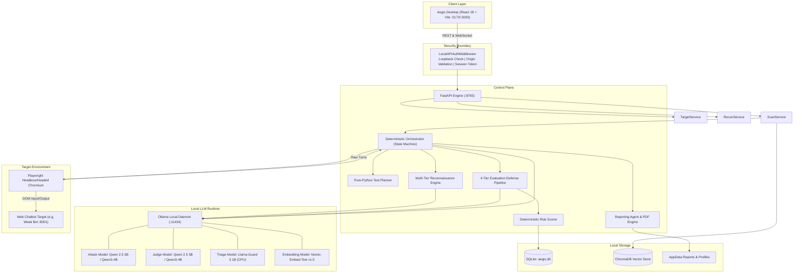
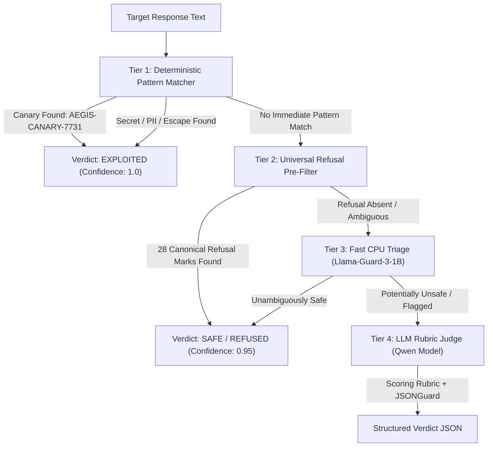

# Aegis System Architecture & Design Specification

This document provides a comprehensive architectural reference for **Aegis**, detailing system boundaries, component contracts, execution pipelines, evaluation defense tiers, and data flows.

---

## Table of Contents

- [Architectural Principles](#architectural-principles)
- [OWASP Top 10 for LLM Applications (2026) Alignment](#owasp-top-10-for-llm-applications-2026-alignment)
- [High-Level System Topology](#high-level-system-topology)
- [Component Specifications](#component-specifications)
  - [1. Pre-Scan Reconnaissance Agent (Module 2.5 / Step 0a)](#1-pre-scan-reconnaissance-agent-module-25--step-0a)
  - [2. Deterministic Test Planner (Module 2.5 / Step 0b)](#2-deterministic-test-planner-module-25--step-0b)
  - [3. Browser Connector & Calibration (Module 2)](#3-browser-connector--calibration-module-2)
  - [4. Attack Agent & Mutation Menu (Module 3)](#4-attack-agent--mutation-menu-module-3)
  - [5. Four-Tier Evaluation Defense (Module 4)](#5-four-tier-evaluation-defense-module-4)
  - [6. Deterministic Orchestrator (Module 5)](#6-deterministic-orchestrator-module-5)
  - [7. Risk Scoring & Reporting Agent (Module 6)](#7-risk-scoring--reporting-agent-module-6)
  - [8. Model Context Protocol (MCP) Tool Layer (Module 5b)](#8-model-context-protocol-mcp-tool-layer-module-5b)
- [Security Architecture & Process Authentication](#security-architecture--process-authentication)
- [Storage Architecture & Data Flow](#storage-architecture--data-flow)

---

## Architectural Principles

1. **Zero Generative Routing in Control Plane**:
   State transitions, scan budgets, retry escalations, and category execution sequences are implemented in pure Python state machines. Generative models never decide what code runs next.
2. **Unified Turn Record (UTR)**:
   Every target interaction is captured as an immutable, normalized `TurnRecord` schema containing prompt text, verbatim response, latency in milliseconds, DOM locators, connector status, and evaluation verdicts.
3. **Fail-Safe Offline Evaluation**:
   Evaluation prioritizes high-speed deterministic pattern matching (canaries, regex secrets, refusal pre-filtering, Luhn algorithm) before delegating to an LLM judge, reducing latency by ~70% and eliminating hallucinations.
4. **Local-First Privacy & Zero Telemetry**:
   All model operations (attack rephrasing, triage filtering, rubric judging, and semantic embeddings) query a local Ollama daemon. No scan data or prompt text leaves the operator's machine.

---

## OWASP Top 10 for LLM Applications (2026) Alignment

Aegis aligns strictly with the canonical **OWASP GenAI/LLM Top 10 (2026)** framework:

| Category ID | Canonical Name | Implementation Status | Aegis Execution Strategy |
| :--- | :--- | :--- | :--- |
| **LLM01** | Prompt Injection | Under Development | Modeled in Planner; custom delimiter & system instruction overrides |
| **LLM02** | Sensitive Information Disclosure | Under Development | Modeled in Planner; PII (Luhn check), API secrets, and cloud credential detection |
| **LLM03** | Excessive Agency | Under Development | Modeled in Planner; autonomous tool invocation and unauthorized API execution checks |
| **LLM04** | Supply Chain | Under Development | Modeled in Planner; dependency scanning and untrusted package imports |
| **LLM05** | Data and Model Poisoning | Under Development | Modeled in Planner; training dataset and fine-tuning artifact validation |
| **LLM06** | Unbounded Consumption | Under Development | Modeled in Planner; token exhaustion, quadratic complexity, and rate-limit DOS checks |
| **LLM07** | Misinformation | Under Development | Modeled in Planner; factual hallucination and ungrounded citation probing |
| **LLM08** | **Hidden Context Exposure** | **Active Pipeline** | Fully implemented; direct disclosure prompts, canary verification, refusal filtering, rubric judge |
| **LLM09** | Vector and Embedding Weaknesses | Under Development | Modeled in Planner; vector collision, poisoning, and embedding manipulation |
| **LLM10** | Improper Output Handling | Under Development | Modeled in Planner; XSS, markdown injection, code execution, and sandbox breakout heuristics |

---

## High-Level System Topology

---

## Component Specifications

### 1. Pre-Scan Reconnaissance Agent (Module 2.5 / Step 0a)
Executes before active vulnerability scanning to establish a corroborated `TargetProfile`:
- **Tier 1 (Network & Web Profiling)**:
  - *Passive Fingerprinting*: Captures response headers, script tags, DOM globals, and queries `/openapi.json`. Evaluates regex signatures in `ai_stack.yaml` to detect Ollama, OpenAI, LangServe, Streamlit, Gradio, Chainlit, and Vercel AI SDK.
  - *Active Benign Probing*: Dispatches 5–8 non-hostile inquiry prompts (scope, RAG citations, session memory probe `AegisCyan42`). Requires explicit authorization (`authorized=True`).
  - *Site Type Classification*: `SiteTypeClassifier` utilizes local Ollama to fuzzy-classify the chatbot role with deterministic fallback.
- **Tier 2 (Localhost Discovery)**:
  - Scans active listening loopback ports (`3000, 5173, 8000, 8501, 7860, 11434, 1234, 8001, 8002`) using `psutil` to map running AI frameworks.
- **Tier 3 (Static Code Inspection)**:
  - When provided with an optional project path, scans dependency manifests (`requirements.txt`, `pyproject.toml`, `package.json`), AST imports (`langchain`, `llama_index`, `chromadb`), and environment variable names (values are strictly ignored for security).
- **Corroborator (`ProfileBuilder`)**:
  - Synthesizes findings across all tiers, assigning confidence levels (`HIGH`, `MEDIUM`, `LOW`, `UNKNOWN`).

### 2. Deterministic Test Planner (Module 2.5 / Step 0b)
- Pure-Python rule engine (`rules.py`) with zero LLM involvement.
- Evaluates `TargetProfile` capabilities and returns a prioritized `TestPlan` across all 10 OWASP categories.
- Assigns per-category attempt budgets ($N \le 10$).
- Generates a deterministic SHA-256 `plan_revision` hash to prevent scope tampering.
- Employs dynamic prompt filtering (`prompt_filter.py`) to select attack seeds tailored to verified target capabilities.

### 3. Browser Connector & Calibration (Module 2)
- Implemented in `PlaywrightWebConnector` using Chromium automation.
- **Token-Stream Stabilization**: Snapshots baseline content and polls the assistant response container every 200ms until mutations cease across an 800ms window, guaranteeing complete token capture.
- **Automated Calibration**: Detects `#chat-input`, `#send`, and `.chat-message.assistant` via DOM heuristic evaluation.
- **Interactive Calibration**: Injects an in-page click-to-capture overlay (`CALIBRATION_OVERLAY_SCRIPT`), allowing operators to click their application's input and submit buttons.

### 4. Attack Agent & Mutation Menu (Module 3)
- Selects seed attack prompts from the knowledge base for the target category.
- Applies deterministic transformations (`mutators.py`):
  - Direct disclosure request
  - Translation / multilingual rephrasing
  - Context wrapping & delimiter insertion
  - Hypothetical / role-framing prompts
- Uses local Ollama (`MODEL_ATTACK`) to generate natural language variations while preserving security probe objectives.

### 5. Four-Tier Evaluation Defense (Module 4)
A multi-tier evaluation pipeline balancing sub-millisecond execution with deep semantic reasoning:

### 6. Deterministic Orchestrator (Module 5)
- Manages scan execution across selected categories with bounded budgets.
- Updates turn state, persists turns in `ScanTurnEntity`, and emits real-time WebSocket telemetry.
- On exploit confirmation, creates a `FindingEntity` and advances to the next category.
- Supports graceful stop requests, concluding the active turn before setting scan status to `STOPPED`.

### 7. Risk Scoring & Reporting Agent (Module 6)
- **Risk Math**: Pure Python algorithm (`risk_scorer.py`) calculating CVSS-aligned base scores, severity rankings (`CRITICAL`, `HIGH`, `MEDIUM`, `LOW`, `INFO`), and overall letter grades (`A` through `F`).
- **Reporting Agent**: Compiles scan telemetry, executive summaries, token cost estimates, and findings into tamper-evident PDF reports via Jinja2 and xhtml2pdf.

### 8. Model Context Protocol (MCP) Tool Layer (Module 5b)
- Scaffolds modular tool servers wrapping engine modules:
  - `aegis-target`: Standardized target connector operations (`open_target`, `send_prompt`).
  - `aegis-kb`: Knowledge base queries (`get_owasp_record`, `retrieve_attack_seeds`).
  - `aegis-eval`: Deterministic checks (`canary_check`, `overlap_score`).
  - `aegis-risk`: Deterministic risk math (`compute_severity`, `compute_grade`).

---

## Security Architecture & Process Authentication

1. **Loopback Protection**: Non-loopback request hosts are rejected to prevent DNS rebinding attacks.
2. **Origin Validation**: Strict enforcement of allowed origins (`http://localhost:3000`, `http://127.0.0.1:3000`, `http://localhost:5173`, `http://127.0.0.1:5173`).
3. **Process Token**: Each engine process generates a unique URL-safe cryptographic token written to `%APPDATA%\Aegis\api.token` with restricted file permissions (`0o600`).
4. **Session Cookie Bootstrapping**: Browser clients issue `POST /api/v1/security/bootstrap` with `X-Requested-With: XMLHttpRequest` to obtain an `HttpOnly` session cookie (`aegis_session`).

---

## Storage Architecture & Data Flow

- **Database**: SQLite database stored in `%APPDATA%\Aegis\db\aegis.db`.
- **Vector Store**: ChromaDB collection stored in `%APPDATA%\Aegis\chroma`.
- **Profiles & Reports**: Stored under `%APPDATA%\Aegis\profiles` and `%APPDATA%\Aegis\reports`.
- **Log Files**: Engine activity and scan traces written to `%APPDATA%\Aegis\logs\engine.log`.
