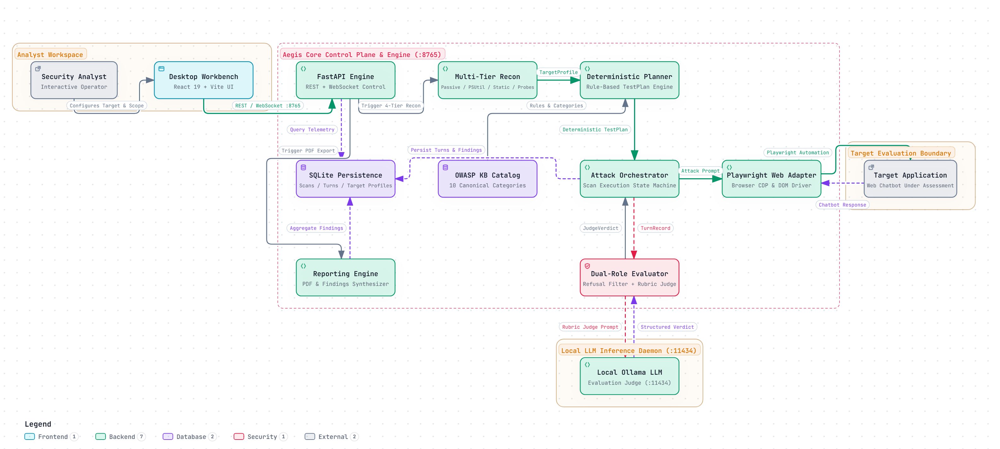
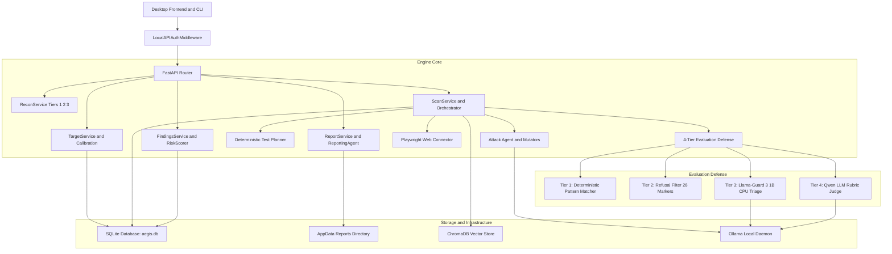
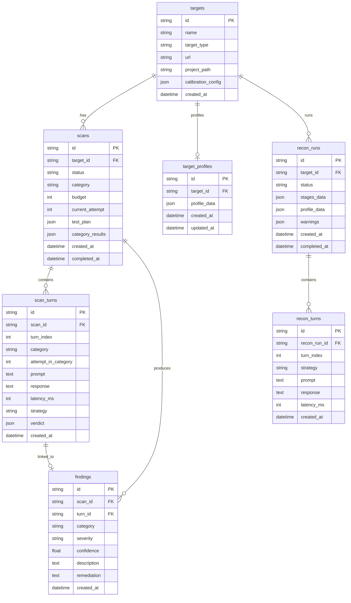

# Aegis Engine (Control Plane & Backend)

The **Aegis Engine** is the core backend control plane for the Aegis automated red-teaming workbench. It is implemented in Python using FastAPI, SQLAlchemy, and Playwright, providing deterministic scan orchestration, multi-tier reconnaissance, browser automation, multi-tier vulnerability evaluation, and an Ollama-driven LLM runtime.

---

## Table of Contents

- [Overview](#overview)
- [Architecture & Responsibilities](#architecture--responsibilities)
- [Directory Layout](#directory-layout)
- [Core Subsystems](#core-subsystems)
  - [1. Deterministic Orchestrator](#1-deterministic-orchestrator)
  - [2. Multi-Tier Reconnaissance (`app/recon`)](#2-multi-tier-reconnaissance-apprecon)
  - [3. Deterministic Test Planner (`app/agents/planner`)](#3-deterministic-test-planner-appagentsplanner)
  - [4. Playwright Web Connector & Calibration (`app/adapters`)](#4-playwright-web-connector--calibration-appadapters)
  - [5. Attack Agent & Mutators (`app/agents`)](#5-attack-agent--mutators-appagents)
  - [6. Four-Tier Evaluation Defense (`app/agents/evaluation`)](#6-four-tier-evaluation-defense-appagentsevaluation)
  - [7. RAG Knowledge Base & ChromaDB (`app/rag`)](#7-rag-knowledge-base--chromadb-apprag)
  - [8. Model Context Protocol (MCP) Tool Servers (`app/mcp`)](#8-model-context-protocol-mcp-tool-servers-appmcp)
- [Database Architecture & Schema](#database-architecture--schema)
- [Security & Process-Scoped Local Auth](#security--process-scoped-local-auth)
- [API Reference](#api-reference)
  - [Health & System](#health--system)
  - [Targets & Calibration](#targets--calibration)
  - [Reconnaissance & Planning](#reconnaissance--planning)
  - [Scans & Execution](#scans--execution)
  - [Findings & Reports](#findings--reports)
  - [WebSocket Telemetry](#websocket-telemetry)
- [Setup & Running Locally](#setup--running-locally)
- [Testing & Validation](#testing--validation)

---

## Overview

The engine acts as the authoritative control plane for all security assessments. It enforces strict architectural principles:
- **Zero Generative Routing in Control Plane**: Scan budgets, turn state transitions, category prioritization, and retry logic are implemented in pure Python state machines. Generative models never decide execution flow.
- **Unified Turn Record**: Every target interaction is captured as a canonical `TurnRecord` containing prompt, response, latency, DOM selectors, connector status, and evaluation verdicts.
- **Fail-Safe Offline Evaluation**: Evaluates responses through high-speed deterministic pattern matching and fast triage before delegating to an LLM rubric judge.
- **Local-Only Inference**: All LLM operations query a local [Ollama](http://localhost:11434) daemon. No cloud APIs or telemetry are required.

---

## Architecture & Responsibilities



*Figure: Aegis core control plane, multi-tier reconnaissance, execution state machine, and local LLM evaluation boundary.*



---

## Directory Layout

```
engine/
├── app/
│   ├── adapters/            # Target interaction connectors (Playwright web, calibration, proxies)
│   │   ├── base.py          # BaseConnector abstract interface
│   │   ├── cert_manager.py  # Self-signed certificate management for MITM proxying
│   │   ├── playwright_web.py# Playwright web chatbot connector & token-stream stabilizer
│   │   ├── proxy_app.py     # HTTP/S proxy target connector (scaffolded)
│   │   ├── registry.py      # Connector factory registry
│   │   ├── uia_app.py       # Windows UI Automation connector (scaffolded)
│   │   └── web_calibration.py# Automated & interactive DOM selector calibration
│   ├── agents/              # Pipeline agent implementations
│   │   ├── assistant_agent.py# RAG-powered interactive Q&A assistant
│   │   ├── attack_agent.py  # Seed prompt selector and LLM rephraser
│   │   ├── mutators.py      # Deterministic non-jailbreak prompt mutation operators
│   │   ├── orchestrator.py  # Pure-Python deterministic scan state machine
│   │   ├── reporting_agent.py# Executive narrative and PDF report builder
│   │   ├── risk_scorer.py   # Deterministic CVSS/OWASP severity & grading engine
│   │   ├── state.py         # Orchestrator state and attempt budget models
│   │   ├── evaluation/      # Four-tier evaluation defense
│   │   │   ├── deterministic.py # Canaries, secret regex, Luhn card check, refusal filter
│   │   │   ├── evaluator.py # Multi-stage evaluation coordinator
│   │   │   ├── judge.py     # LLM rubric judge with JSONGuard validation
│   │   │   └── triage.py    # Llama-Guard-3-1B CPU safety triage filter
│   │   └── planner/         # Deterministic test planning engine
│   │       ├── category_catalog.py # Authoritative OWASP Top 10 2026 catalog
│   │       ├── prompt_filter.py    # Profile capability prompt filtering
│   │       └── rules.py     # Pure-Python test plan generator & SHA-256 revisioning
│   ├── api/v1/              # FastAPI HTTP & WebSocket route handlers
│   │   ├── assistant.py     # /assistant endpoints (RAG status and chat)
│   │   ├── findings.py      # /findings endpoints (lists, summaries, details)
│   │   ├── health.py        # /health readiness check
│   │   ├── proxy.py         # /proxy endpoints (scaffolded)
│   │   ├── reports.py       # /reports endpoints (PDF generation and downloads)
│   │   ├── router.py        # Master FastAPI application and middleware mounting
│   │   ├── scans.py         # /scans endpoints (start, poll, turns, stop)
│   │   ├── security.py      # /security session bootstrap and CSRF protection
│   │   ├── targets.py       # /targets endpoints (CRUD, calibration, recon, plan)
│   │   └── websocket.py     # /ws/telemetry live scan streaming
│   ├── core/                # System configuration, paths, and database setup
│   │   ├── api_auth.py      # Local API authentication & loopback origin validation
│   │   ├── config.py        # Pydantic Settings (AEGIS_* environment variables)
│   │   ├── cost_estimator.py# Multi-model token cost estimation for reports
│   │   ├── database.py      # SQLAlchemy session factory and database initialization
│   │   ├── errors.py        # Standardized domain error classes
│   │   ├── events.py        # In-memory pub/sub event bus
│   │   ├── logging.py       # JSON/structured console & file logging
│   │   └── paths.py         # Cross-platform application data directory resolution
│   ├── kb/                  # Static markdown knowledge base loader
│   ├── llm/                 # Ollama client and JSON schema guards
│   │   ├── json_guard.py    # Balanced-brace JSON extractor and Pydantic validator
│   │   └── ollama_client.py # Async HTTP wrapper for Ollama generate/embed endpoints
│   ├── mcp/                 # Model Context Protocol (MCP) tool servers
│   │   ├── client.py        # In-process MCP tool client
│   │   ├── tool_schemas.py  # Standard JSON Schema definitions for tools
│   │   └── servers/         # Specialized tool servers (target, kb, eval, risk)
│   ├── models/              # SQLAlchemy database ORM entities
│   │   └── entities.py      # TargetEntity, ScanEntity, ScanTurnEntity, FindingEntity, etc.
│   ├── rag/                 # RAG retrieval and vector storage
│   │   ├── embedder.py      # NomicEmbedder calling local Ollama
│   │   ├── indexer.py       # Markdown chunking and ChromaDB indexing
│   │   ├── retriever.py     # ChromaDB similarity retriever with relevance filtering
│   │   └── vector_store.py  # ChromaDB persistent collection manager
│   ├── recon/               # Multi-tier reconnaissance engine
│   │   ├── classifier.py    # SiteTypeClassifier (Ollama fuzzy classification + fallback)
│   │   ├── fingerprint.py   # SignatureMatcher against ai_stack.yaml
│   │   ├── local_discovery.py# Localhost port and process scanner (psutil)
│   │   ├── network_collector.py # Passive Playwright HTTP header/DOM collector
│   │   ├── probe_runner.py  # Active benign prompt dispatcher
│   │   ├── profile_builder.py# Corroborator assembling TargetProfile
│   │   ├── schemas.py       # Recon data transfer models
│   │   └── static_scanner.py# AST and dependency scanner for project directories
│   ├── schemas/             # Pydantic request/response data contracts
│   └── services/            # Domain service layer
├── knowledge/               # Seed knowledge base documents (OWASP 2026, Aegis guides)
├── tests/                   # Pytest test suite (unit, integration, benchmarks)
├── main.py                  # Engine entrypoint script
└── requirements.txt         # Python package dependencies
```

---

## Core Subsystems

### 1. Deterministic Orchestrator
- Implemented in `app/agents/orchestrator.py` as an asynchronous state machine.
- Manages scan execution across selected categories with strict per-category attempt budgets ($N \le 10$).
- Interacts directly with the `PlaywrightWebConnector`, the `AttackAgent`, and the `EvaluationPipeline`.
- On finding detection (`attack_success = True`), records a confirmed `FindingEntity` and advances to the next category.
- Supports graceful stop via `ScanService.request_stop(scan_id)`, cleanly finalizing the turn at the next boundary.
- Recovers orphaned `RUNNING` scans to `INTERRUPTED` on engine restart.

### 2. Multi-Tier Reconnaissance (`app/recon`)
The reconnaissance engine establishes a corroborated `TargetProfile` adhering to the principle **"Unknown is not absent"**:
- **Tier 1 (Passive & Active Web Profiling)**:
  - *Passive Fingerprinting*: Captures response headers, WebSocket frames, script tags, DOM globals, and well-known paths (`/openapi.json`). Matches against `ai_stack.yaml` to detect Ollama, OpenAI, LangServe, Streamlit, Gradio, Chainlit, and Vercel AI SDK.
  - *Active Benign Probing*: Dispatches 5–8 non-hostile inquiry prompts (scope inquiries, RAG citation probes, and session memory recall with token `AegisCyan42`). Requires explicit authorization (`authorized=True`).
  - *Fuzzy Classification*: Classifies target interface type (`SiteTypeClassifier`) using local Ollama with deterministic fallback.
- **Tier 2 (Localhost Discovery)**:
  - Uses `psutil` to identify active processes listening on AI development ports (`3000, 5173, 8000, 8501, 7860, 11434, 1234, 8001, 8002`).
- **Tier 3 (Static Project Scanner)**:
  - When provided with an optional project directory path, inspects dependency manifests (`pyproject.toml`, `package.json`, `requirements.txt`), Python AST imports (`langchain`, `chromadb`, etc.), and environment variable names (values are strictly ignored for privacy).

### 3. Deterministic Test Planner (`app/agents/planner`)
- Implemented in `rules.py` with zero LLM involvement.
- Evaluates the corroborated `TargetProfile` and generates a prioritized, budgeted `TestPlan` across all 10 canonical OWASP Top 10 (2026) categories.
- Produces a tamper-evident SHA-256 `plan_revision` hash.
- Dynamically selects seeds from the knowledge base using `prompt_filter.py` based on verified target capabilities.

### 4. Playwright Web Connector & Calibration (`app/adapters`)
- Bridges the orchestrator to web chatbot applications using Chromium automation.
- **Streaming Stabilization**: Polls the response DOM container every 200ms until mutations cease across an 800ms window, capturing full streaming LLM tokens.
- **Automated Calibration**: Inspects DOM heuristics to find `#chat-input`, `#send`, and `.chat-message.assistant`.
- **Interactive Calibration**: Injects an in-page overlay (`CALIBRATION_OVERLAY_SCRIPT`) allowing users to visually click their chat input and submit buttons.

### 5. Attack Agent & Mutators (`app/agents`)
- Retrieves seed prompts tailored to the active category (e.g., direct system prompt requests for `LLM08`).
- Applies non-jailbreak transformations via `mutators.py` (translation, framing, delimiter insertion, context wrapping).
- Uses the local LLM (`MODEL_ATTACK`) to generate natural language variations without altering the underlying security probe.

### 6. Four-Tier Evaluation Defense (`app/agents/evaluation`)
Combines instant deterministic pattern checks with fast triage and rubric-based judging:
1. **Tier 1: Deterministic Pattern Matcher (`deterministic.py`)**:
   - Canary validation: detects planted test tokens (`AEGIS-CANARY-7731`) with 100% confidence.
   - Secret regexes: Dora signatures for AWS keys, GitHub PATs, Slack tokens, Stripe keys, and OpenAI keys.
   - Container breakout heuristics: Docker socket paths, Kubernetes service tokens, Linux capability tables.
   - PII detection: Emails, SSNs, and credit cards validated via the **Luhn algorithm**.
   - N-gram overlap: Trigram and character shingle overlap against ground-truth prompts.
2. **Tier 2: Universal Refusal Pre-Filter (`deterministic.py`)**:
   - Matches against 28 canonical refusal markers (`REFUSAL_MARKS`).
   - If a refusal phrase is found without exploit indicators, classifies `exploited = False` with 95% confidence, short-circuiting and bypassing LLM calls (saving ~70% latency).
3. **Tier 3: Fast CPU Triage (`triage.py`)**:
   - Uses `llama-guard3:1b` (CPU-offloaded) for rapid safe/unsafe binary triage.
4. **Tier 4: LLM Rubric Judge (`judge.py`)**:
   - Queries `MODEL_JUDGE` using specialized Markdown rubrics (e.g. `judge_rubric_llm08.md`).
   - Enforces the **Summarized-Result Exploitation Principle** (accurate summaries of internal instructions constitute a disclosure).
   - Validates JSON output via `JSONGuard` with balanced-brace depth tracking and bounded retries ($N \le 2$).

### 7. RAG Knowledge Base & ChromaDB (`app/rag`)
- Semantic chunks from `knowledge/` are indexed into a persistent ChromaDB collection.
- Uses `nomic-embed-text` over local Ollama with task prefixing (`search_document:` / `search_query:`).
- `AssistantAgent` queries this vector store to provide contextual remediation advice and OWASP citations in the interactive assistant view.

### 8. Model Context Protocol (MCP) Tool Servers (`app/mcp`)
- Implements the MCP architecture to expose engine capabilities as standardized tools:
  - `aegis-target`: `open_target`, `calibrate_target`, `send_prompt`, `close_target`
  - `aegis-kb`: `get_owasp_record`, `retrieve_attack_seeds`, `get_eval_criteria`
  - `aegis-eval`: `canary_check`, `overlap_score`
  - `aegis-risk`: `compute_severity`, `compute_grade`
- Prepares Aegis for modular extension to desktop and API scanning targets.

---

## Database Architecture & Schema

The engine uses **SQLite** located at `%APPDATA%\Aegis\db\aegis.db` (managed via SQLAlchemy):



---

## Security & Process-Scoped Local Auth

The engine is hardened against unauthorized local access and DNS rebinding attacks:
- **Loopback Enforcement**: Accepts requests only from `127.0.0.1` and `localhost`. External interfaces are rejected.
- **Trusted Origin Matching**: Verifies the `Origin` header against explicit UI origins (`http://localhost:3000`, `http://127.0.0.1:3000`, `http://localhost:5173`, `http://127.0.0.1:5173`).
- **Process Token Authentication**: A high-entropy URL-safe token is generated per engine run and written to `%APPDATA%\Aegis\api.token` with restricted permissions.
- **Browser Session Bootstrapping**: Trusted browser clients bootstrap via `POST /api/v1/security/bootstrap` with an `X-Requested-With: XMLHttpRequest` header to obtain an `HttpOnly` session cookie (`aegis_session`), protecting against cross-site request forgery.

---

## API Reference

Base URL: `http://127.0.0.1:8765/api/v1`

### Health & System
- `GET /health`
  - Returns readiness and Ollama connectivity.
  - Response: `{"status": "ok", "ollama_available": true, "version": "0.1.0"}`
- `GET /assistant/status`
  - Returns RAG status, indexed chunks count, and active model.
- `POST /assistant/chat`
  - Body: `{"query": "How do I mitigate LLM08 in LangChain?", "scan_id": "optional-uuid"}`
  - Returns streaming or full grounded response with citations.

### Targets & Calibration
- `POST /targets`
  - Body: `{"name": "Acme Support Bot", "target_type": "web", "url": "http://127.0.0.1:8001"}`
- `GET /targets` — List registered targets.
- `GET /targets/{id}` — Target details and stored calibration.
- `POST /targets/{id}/calibrate/auto` — Run automated Playwright selector detection.
- `POST /targets/{id}/calibrate/interactive` — Launch visible browser with click-to-capture overlay.
- `GET /targets/{id}/calibrate/interactive/{session_id}` — Poll interactive calibration status.
- `POST /targets/{id}/calibrate`
  - Body: `{"input_selector": "#chat-input", "send_selector": "#send", "response_selector": ".chat-message.assistant"}`

### Reconnaissance & Planning
- `POST /targets/{id}/recon`
  - Body: `{"project_path": "optional/path", "run_probes": false, "authorized": true}`
  - Executes multi-tier profiling and returns a corroborated `TargetProfile`.
- `GET /targets/{id}/profile` — Retrieve saved `TargetProfile`.
- `GET /targets/local/discover` — Scan listening loopback development ports via `psutil`.
- `POST /targets/{id}/plan` — Generate deterministic `TestPlan` across all 10 OWASP categories.

### Scans & Execution
- `POST /scans/start`
  - Body:
    ```json
    {
      "target_id": "target-uuid",
      "category": "LLM08",
      "category_ids": ["LLM08"],
      "plan_revision": "sha256-digest",
      "budget": 10,
      "authorized": true
    }
    ```
  - Starts scan background worker; returns `ScanEntity` with ID.
- `GET /scans/{id}` — Poll scan status, current attempt, and category progress.
- `GET /scans/{id}/turns` — Replay all turns with recorded latencies, prompts, responses, and verdicts.
- `POST /scans/{id}/stop` — Requests graceful termination at the next turn boundary.

### Findings & Reports
- `GET /findings/{scan_id}` — Confirmed vulnerability findings.
- `GET /findings/{scan_id}/summary` — Findings counts by severity (`CRITICAL`, `HIGH`, `MEDIUM`, `LOW`, `INFO`) and risk grade.
- `GET /findings/detail/{finding_id}` — Detailed finding with linked turn prompt and response quote.
- `POST /reports/{scan_id}/generate` — Compiles PDF report via Jinja2 & xhtml2pdf.
- `GET /reports/{scan_id}/pdf` — Stream cached PDF binary.

### WebSocket Telemetry
- `WS /ws/telemetry/{scan_id}`
  - Emits real-time JSON events:
    - `turn_started`: `{"event": "turn_started", "turn_index": 1, "category": "LLM08", "prompt": "..."}`
    - `turn_completed`: `{"event": "turn_completed", "turn_index": 1, "verdict": {...}, "latency_ms": 1420}`
    - `scan_completed`: `{"event": "scan_completed", "status": "COMPLETED", "findings_count": 1}`
    - `scan_failed`: `{"event": "scan_failed", "error": "Connection timeout"}`

---

## Setup & Running Locally

1. **Activate Virtual Environment**:
   ```powershell
   # From repository root
   .\.venv\Scripts\Activate.ps1
   ```

2. **Verify Configuration**:
   Ensure `.env` in the repository root or `engine/` points to your Ollama models:
   ```ini
   AEGIS_HOST=127.0.0.1
   AEGIS_PORT=8765
   AEGIS_OLLAMA_BASE_URL=http://localhost:11434
   AEGIS_MODEL_ATTACK=qwen2.5:3b
   AEGIS_MODEL_JUDGE=qwen2.5:3b
   AEGIS_MODEL_TRIAGE=llama-guard3:1b
   AEGIS_MODEL_EMBED=nomic-embed-text:v1.5
   AEGIS_PLAYWRIGHT_HEADLESS=True
   ```

3. **Start the Engine**:
   ```powershell
   cd engine
   python main.py
   ```
   The engine initializes the database schema, ensures application directories exist, and listens on `http://127.0.0.1:8765`.

---

## Testing & Validation

Aegis includes an extensive test suite covering unit tests, multi-stage flows, and evaluation benchmarks:

```powershell
# Run all unit tests
pytest engine/tests/unit -v

# Run integration tests
pytest engine/tests/integration -v

# Run judge rubric benchmark verification
pytest engine/tests/benchmarks/test_judge_benchmarks.py -v

# Verify Gate 4 end-to-end criteria
python scripts/verify_gate4.py
```

